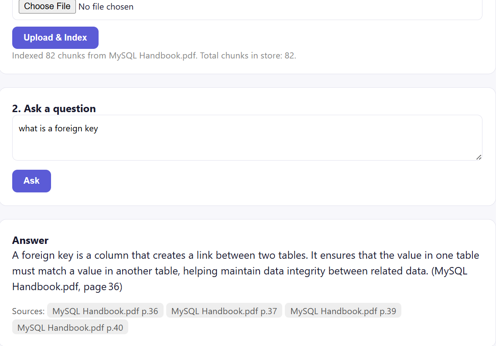
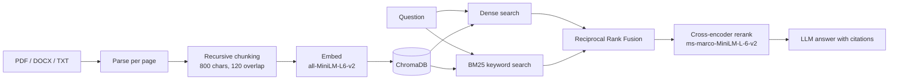

# Enterprise AI Knowledge Assistant

Ask questions about your own documents in plain English and get answers that cite the source file and page.

A Retrieval-Augmented Generation (RAG) system built with **FastAPI**, **ChromaDB** and a hybrid retrieval pipeline (dense vectors + BM25 + cross-encoder reranking). Retrieval quality is measured, not assumed: the repo includes a labeled evaluation set and the scripts that produced the numbers below.



## What it does

- Upload `.pdf`, `.docx`, `.txt` or `.md` files; they are parsed, chunked, embedded and indexed.
- Ask a question; the system retrieves the most relevant chunks and has an LLM answer **only from that context**, citing `(source, page)`.
- If the documents don't contain the answer, the model is instructed to say so instead of guessing.
- Works with a free LLM (Groq, local Ollama), OpenAI or Anthropic. With no key at all it still runs and returns the raw retrieved context.

## How it works



| Stage | File | Notes |
|---|---|---|
| Parsing | `app/document_processor.py` | PDF text per page, so every chunk keeps `source` and `page` metadata |
| Chunking | `app/chunking.py` | Hand-written recursive splitter: paragraphs, then lines, sentences, words |
| Embeddings | `app/embeddings.py` | Local sentence-transformers model, no API cost |
| Vector store | `app/vector_store.py` | ChromaDB wrapper, dense search, RRF fusion, reranking |
| Keyword search | `app/keyword_search.py` | In-memory BM25 rebuilt from ChromaDB when chunks change |
| Reranker | `app/reranker.py` | Cross-encoder rescoring of the fused shortlist |
| LLM layer | `app/llm.py` | Groq/Ollama (any OpenAI-compatible endpoint), OpenAI, Anthropic, or raw-context fallback |
| API | `app/main.py` | `POST /api/ingest`, `POST /api/query`, `GET /api/health`, demo UI at `/` |

Why hybrid retrieval: dense search handles paraphrase but can miss exact tokens (commands, IDs, names); BM25 does the reverse. Reciprocal Rank Fusion merges the two ranked lists using rank position only, so the two score scales never need normalizing. The cross-encoder then reads the question and each candidate together, which is more precise than comparing two separately computed vectors, but too slow to run over the whole corpus, so it only rescores the shortlist.

## Evaluation

Retrieval is evaluated with **no LLM involved**, so results are cheap to reproduce and not affected by the answer model.

- **Corpus:** one document, a MySQL handbook PDF (82 chunks)
- **Questions:** 50 labeled questions (`eval/eval_questions.json`), plus 5 deliberately unanswerable ones used to check that the model says "I don't know"
- **Labels:** each question has a `must_contain` phrase copied from the passage that answers it; a retrieved chunk counts as relevant if it contains that phrase
- **Metrics:** Hit@k (a relevant chunk is in the top k) and MRR (mean of 1 / rank of the first relevant chunk). Each question has one label, so Recall@k equals Hit@k.

| Retrieval | Hit@1 | Hit@3 | Hit@5 | MRR |
|---|---|---|---|---|
| Dense only | 0.60 | 0.88 | 0.96 | 0.74 |
| BM25 only | 0.50 | 0.86 | 0.86 | 0.66 |
| Hybrid (RRF) | 0.66 | 0.86 | 0.94 | 0.77 |
| **Hybrid + rerank** | **0.74** | **0.94** | **0.96** | **0.83** |

Full report: [`eval/retrieval_report.md`](eval/retrieval_report.md).

**How to read this**

- Reranking mainly improves the *ordering*: Hit@1 goes from 0.60 to 0.74 and MRR from 0.74 to 0.83 versus dense-only.
- Hit@5 is already near its ceiling for dense search on this corpus (0.96), so the pipeline does not add recall there. Hybrid without reranking was not better than dense on Hit@3 or Hit@5.
- The set is small and comes from a single document, so differences of a few points are within noise. Treat the numbers as indicative, not general.
- Label matching ignores whitespace, because PDF extraction inserts stray spaces and line breaks. An earlier run without this undercounted hits for every configuration, so its numbers are superseded.
- Questions were written from the document's own wording, which favors keyword matching. Real user questions are usually vaguer.

Reproduce:

```bash
python -m eval.retrieval_eval          # writes eval/retrieval_report.md
```

Answer quality can also be scored with [Ragas](https://github.com/explodinggradients/ragas) (faithfulness, answer relevancy, context precision), with the answer model and the judge model configured separately:

```bash
python -m eval.run_eval                       # generate answers, then judge
python -m eval.run_eval --reuse-samples       # re-judge saved answers
```

## Quick start

**Requirements:** Python **3.11 or 3.12** (3.13 is not supported by the pinned dependencies), internet access on first run to download the embedding and reranker models.

```bash
git clone https://github.com/arsheen2244/verity-ai-knowledge-assistant.git
cd verity-ai-knowledge-assistant

python -m venv .venv
# Windows:  .venv\Scripts\activate        macOS/Linux:  source .venv/bin/activate
python -m pip install -r requirements.txt

cp .env.example .env        # Windows: copy .env.example .env
# edit .env to choose an LLM provider (see below)

python -m uvicorn app.main:app --reload
```

Open <http://127.0.0.1:8000> for the UI or <http://127.0.0.1:8000/docs> for the API docs. Upload a document, then ask a question.

> Start the server with `python -m uvicorn` so it uses the active environment's packages. If you use conda alongside a virtualenv, make sure only one environment is active.

### Choosing an LLM

Set `LLM_PROVIDER` in `.env`:

| Provider | Settings |
|---|---|
| Groq (free tier) | `LLM_PROVIDER=ollama`, `OLLAMA_BASE_URL=https://api.groq.com/openai/v1`, `OLLAMA_API_KEY=<key>`, `OLLAMA_MODEL=openai/gpt-oss-120b`, `OLLAMA_MAX_TOKENS=2000` |
| Local Ollama | `LLM_PROVIDER=ollama`, then `ollama pull llama3.2:3b` and use the defaults in `.env.example` |
| OpenAI | `LLM_PROVIDER=openai`, `OPENAI_API_KEY=<key>` |
| Anthropic | `LLM_PROVIDER=anthropic`, `ANTHROPIC_API_KEY=<key>` |
| None | `LLM_PROVIDER=none` returns the raw retrieved context |

The `ollama` provider name is historical: it means any OpenAI-compatible endpoint. Never commit your `.env`; it is listed in `.gitignore`.

### Retrieval settings

| Variable | Default | Meaning |
|---|---|---|
| `CHUNK_SIZE` / `CHUNK_OVERLAP` | 800 / 120 | Characters per chunk and overlap between chunks |
| `TOP_K` | 4 | Chunks passed to the LLM |
| `HYBRID_ENABLED` | true | Dense + BM25 with Reciprocal Rank Fusion |
| `HYBRID_CANDIDATE_K` | 20 | Candidates from each retriever |
| `RERANK_ENABLED` | true | Cross-encoder rescoring of the shortlist |

Turn `HYBRID_ENABLED` and `RERANK_ENABLED` off and rerun the evaluation to compare configurations on your own documents.

## API

| Endpoint | Description |
|---|---|
| `POST /api/ingest` | Multipart file upload; returns chunks indexed and total chunks in the store |
| `POST /api/query` | `{"question": "...", "top_k": 4}` returns `answer`, deduplicated `sources`, `retrieved_chunks` |
| `GET /api/health` | Status and number of indexed chunks |

## Tests

```bash
pytest -q
```

Covers chunking, Reciprocal Rank Fusion, the retrieval metrics, and an offline ingest-to-answer pipeline test that needs no API key.

## Known limitations

- **Single-document evaluation.** Results have not been checked on other document types or larger corpora.
- **Chunk size is approximate.** Overlap is added after splitting, so chunks can exceed `CHUNK_SIZE`, and overlaps can begin mid-word.
- **Page granularity.** Chunks never span pages, and `.docx`, `.txt` and `.md` files are all reported as page 1. Tables and images are not extracted.
- **Citations are model-written.** The `sources` list is the set of retrieved chunks, not a verified list of the chunks the answer actually used.
- **Fallback modes.** If the embedding or reranker model cannot load (for example, no network), the app falls back to hashed embeddings or skips reranking, with a warning in the log. Do not query an index built in a different mode.
- **No authentication** on `/api/ingest`; do not expose the server publicly as is.
- **Single process.** The BM25 index lives in memory, so multiple server workers would not see each other's new uploads.

## Roadmap

- Verify that cited pages appear in the retrieved chunks
- Relevance threshold from the rerank score, so off-topic questions retrieve nothing
- Evaluation on more documents and question styles
- Streaming responses and upload authentication